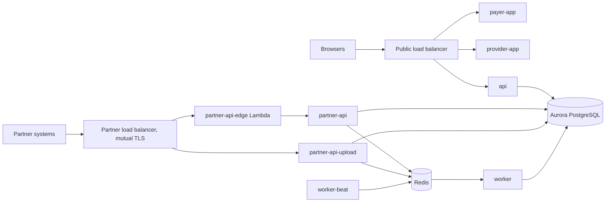

# The platform in one page

Everything below is fictional and sized for the exercise. The source code you
get in the session is the authority on behaviour; this page is the map.

## Services

| Service | What it is | Runs as | Reached through |
|---|---|---|---|
| payer-app | Next.js app for health plan staff (review queue) | ECS Fargate, 2 tasks | public load balancer, `payer.<domain>` |
| provider-app | Next.js app for provider offices | ECS Fargate, 2 tasks | public load balancer, `provider.<domain>` |
| api | Django app API (`GET /api/submissions`) | ECS Fargate, scales with load, gunicorn | public load balancer, `/api/*` on either host |
| worker | Celery worker, consumes every queue | ECS Fargate, 2 tasks | no network ingress |
| worker-beat | Celery beat, schedules periodic tasks | ECS Fargate, exactly 1 task | no network ingress |
| partner-api | Django partner JSON intake (`POST /v1/submissions`) | ECS Fargate, 2 tasks | partner-api-edge only |
| partner-api-upload | Django partner document upload (`POST /v1/documents`) | ECS Fargate, 2 tasks | partner load balancer, path `/v1/documents*` |
| partner-api-edge | Lambda (container image) that forwards partner JSON requests to partner-api | Lambda alias `live` | partner load balancer |

The four Python services (api, worker, partner-api, partner-api-upload) share
one Django project, `services/core`: settings, models, migrations, the Celery
app and the tasks. Each is its own image built from the same source.

## Data flow

- The browser calls the api directly, with the session cookie. The web apps
  are built with the api URL baked in.
- Partners send submissions and documents; the partner services store them
  and queue background work on Redis for the worker.

## Tenancy

One Aurora PostgreSQL database. Each client organization has its own schema;
the request host picks the organization. There are 14 organization schemas in
production (12 clients and 2 demo organizations) plus the public schema. A
migration runs once per schema. The load balancers health-check every task
on `GET /healthz`.

## Infrastructure

- Aurora PostgreSQL 16, one writer. ElastiCache for Redis 7.1, two nodes with
  automatic failover, as the Celery broker and result backend.
- ECS Fargate, one cluster, in private subnets in two availability zones.
  Rolling deployments, minimum healthy 100 percent, maximum 200 percent,
  deployment circuit breaker with rollback. The api scales its task count on
  request load between deploys.
- Each ECS service logs to its own CloudWatch log group.
- Terraform owns the infrastructure and creates the first task definition
  revision of each service; CI owns the running image after that. Terraform is
  applied by a separate workflow after an approving comment on the pull
  request; it is not part of the deploy.

## How a deploy works

`deploy.yml` runs on every push to `main`: change detection; for the backend,
build the four images, register task definition revisions pinned by digest,
run the migration task once (it must finish before any service rolls), roll
every backend service; the partner edge in parallel; then the web apps; then
an advisory smoke check. `rollback.yml` re-points a unit at a previous image
tag and never reverses migrations.

## Operating numbers

- 12 engineers; AI coding agents author most changes. Two production releases
  a week from a release branch, plus the occasional hotfix.
- Peak use is US business hours. Browser sessions last a working day; people
  leave the review queue open all afternoon.
- Partner traffic is a few thousand requests a day, machine to machine, with
  retries on 5xx.
- The client base is growing: two more organizations are onboarding in
  November.
- Alarms post to a channel. There is no paging rotation.
- Customers follow a public status page (`status.example.test`) for outages,
  degraded service and planned maintenance. The incident lead posts to it.
